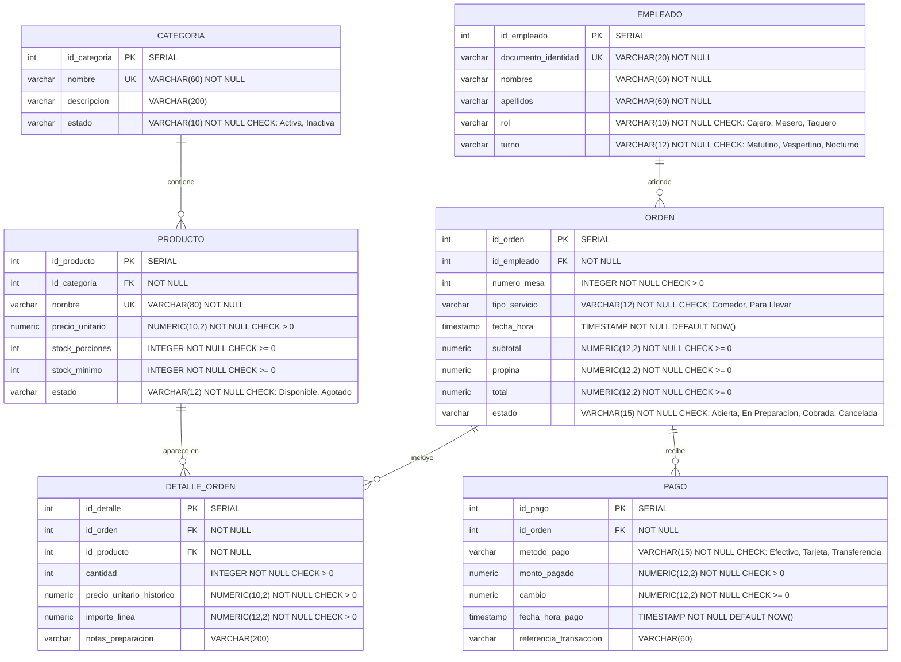

# Modelo Relacional y Diagrama Entidad-Relación
## Sistema de Punto de Venta y Cocina "El Pastor Dorado"

**Motor:** PostgreSQL 13+  
**Modelo:** Relacional en Tercera Forma Normal (3FN)  
**Tablas:** 6  
**Notación:** Crow's Foot (Pata de Gallo)

---

## 1. Convenciones

- **PK:** Primary Key / Llave primaria.
- **FK:** Foreign Key / Llave foránea.
- **UK:** Unique Key / Restricción de unicidad.
- **NOT NULL:** El atributo es obligatorio.
- **CHECK:** Restricción de dominio.
- **SERIAL:** Entero autoincremental generado por PostgreSQL.

---

## 2. Modelo Relacional Detallado

### 2.1 CATEGORIA

Almacena las categorías del menú.

| Atributo | Tipo de dato | Nulidad | Restricción |
|---|---|---|---|
| id_categoria | SERIAL | NOT NULL | PK |
| nombre | VARCHAR(60) | NOT NULL | UNIQUE |
| descripcion | VARCHAR(200) | NULL | — |
| estado | VARCHAR(10) | NOT NULL | CHECK (estado IN ('Activa', 'Inactiva')) |

**Restricciones adicionales:**
- `uq_categoria_nombre`: UNIQUE (nombre).
- `chk_categoria_estado`: CHECK (estado IN ('Activa', 'Inactiva')).

**Valor por defecto:** `estado = 'Activa'`.

---

### 2.2 PRODUCTO

Productos vendibles del restaurante.

| Atributo | Tipo de dato | Nulidad | Restricción |
|---|---|---|---|
| id_producto | SERIAL | NOT NULL | PK |
| id_categoria | INTEGER | NOT NULL | FK → CATEGORIA(id_categoria) |
| nombre | VARCHAR(80) | NOT NULL | UNIQUE |
| precio_unitario | NUMERIC(10,2) | NOT NULL | CHECK (precio_unitario > 0) |
| stock_porciones | INTEGER | NOT NULL | CHECK (stock_porciones >= 0) |
| stock_minimo | INTEGER | NOT NULL | CHECK (stock_minimo >= 0) |
| estado | VARCHAR(12) | NOT NULL | CHECK (estado IN ('Disponible', 'Agotado')) |

**Restricciones adicionales:**
- `fk_producto_categoria`: FK a CATEGORIA, ON UPDATE CASCADE, ON DELETE RESTRICT.
- `chk_producto_precio`, `chk_producto_stock`, `chk_producto_stock_minimo`, `chk_producto_estado`.

**Valores por defecto:** `stock_porciones = 0`, `stock_minimo = 0`, `estado = 'Disponible'`.

---

### 2.3 EMPLEADO

Personal del restaurante.

| Atributo | Tipo de dato | Nulidad | Restricción |
|---|---|---|---|
| id_empleado | SERIAL | NOT NULL | PK |
| documento_identidad | VARCHAR(20) | NOT NULL | UNIQUE |
| nombres | VARCHAR(60) | NOT NULL | — |
| apellidos | VARCHAR(60) | NOT NULL | — |
| rol | VARCHAR(10) | NOT NULL | CHECK (rol IN ('Cajero', 'Mesero', 'Taquero')) |
| turno | VARCHAR(12) | NOT NULL | CHECK (turno IN ('Matutino', 'Vespertino', 'Nocturno')) |

**Restricciones adicionales:**
- `uq_empleado_documento`: UNIQUE (documento_identidad).
- `chk_empleado_rol`, `chk_empleado_turno`.

---

### 2.4 ORDEN

Cabecera de la orden de venta.

| Atributo | Tipo de dato | Nulidad | Restricción |
|---|---|---|---|
| id_orden | SERIAL | NOT NULL | PK |
| id_empleado | INTEGER | NOT NULL | FK → EMPLEADO(id_empleado) |
| numero_mesa | INTEGER | NOT NULL | CHECK (numero_mesa > 0) |
| tipo_servicio | VARCHAR(12) | NOT NULL | CHECK (tipo_servicio IN ('Comedor', 'Para Llevar')) |
| fecha_hora | TIMESTAMP | NOT NULL | DEFAULT NOW() |
| subtotal | NUMERIC(12,2) | NOT NULL | CHECK (subtotal >= 0) |
| propina | NUMERIC(12,2) | NOT NULL | CHECK (propina >= 0) |
| total | NUMERIC(12,2) | NOT NULL | CHECK (total >= 0) |
| estado | VARCHAR(15) | NOT NULL | CHECK (estado IN ('Abierta', 'En Preparacion', 'Cobrada', 'Cancelada')) |

**Restricciones adicionales:**
- `fk_orden_empleado`: FK a EMPLEADO, ON UPDATE CASCADE, ON DELETE RESTRICT.
- `chk_orden_mesa`, `chk_orden_tipo_servicio`, `chk_orden_subtotal`, `chk_orden_propina`, `chk_orden_total`, `chk_orden_estado`.

**Valores por defecto:** `fecha_hora = NOW()`, `subtotal = 0`, `propina = 0`, `total = 0`, `estado = 'Abierta'`.

---

### 2.5 DETALLE_ORDEN

Líneas de producto de cada orden.

| Atributo | Tipo de dato | Nulidad | Restricción |
|---|---|---|---|
| id_detalle | SERIAL | NOT NULL | PK |
| id_orden | INTEGER | NOT NULL | FK → ORDEN(id_orden) |
| id_producto | INTEGER | NOT NULL | FK → PRODUCTO(id_producto) |
| cantidad | INTEGER | NOT NULL | CHECK (cantidad > 0) |
| precio_unitario_historico | NUMERIC(10,2) | NOT NULL | CHECK (precio_unitario_historico > 0) |
| importe_linea | NUMERIC(12,2) | NOT NULL | CHECK (importe_linea > 0) |
| notas_preparacion | VARCHAR(200) | NULL | — |

**Restricciones adicionales:**
- `fk_detalle_orden`: FK a ORDEN, ON UPDATE CASCADE, ON DELETE CASCADE.
- `fk_detalle_producto`: FK a PRODUCTO, ON UPDATE CASCADE, ON DELETE RESTRICT.
- `chk_detalle_cantidad`, `chk_detalle_precio`, `chk_detalle_importe`.

---

### 2.6 PAGO

Pagos aplicados a una orden.

| Atributo | Tipo de dato | Nulidad | Restricción |
|---|---|---|---|
| id_pago | SERIAL | NOT NULL | PK |
| id_orden | INTEGER | NOT NULL | FK → ORDEN(id_orden) |
| metodo_pago | VARCHAR(15) | NOT NULL | CHECK (metodo_pago IN ('Efectivo', 'Tarjeta', 'Transferencia')) |
| monto_pagado | NUMERIC(12,2) | NOT NULL | CHECK (monto_pagado > 0) |
| cambio | NUMERIC(12,2) | NOT NULL | CHECK (cambio >= 0) |
| fecha_hora_pago | TIMESTAMP | NOT NULL | DEFAULT NOW() |
| referencia_transaccion | VARCHAR(60) | NULL | — |

**Restricciones adicionales:**
- `fk_pago_orden`: FK a ORDEN, ON UPDATE CASCADE, ON DELETE CASCADE.
- `chk_pago_metodo`, `chk_pago_monto`, `chk_pago_cambio`.

**Valores por defecto:** `cambio = 0`, `fecha_hora_pago = NOW()`.

---

## 3. Relaciones y Cardinalidades

| Relación | Cardinalidad | Descripción | FK |
|---|---|---|---|
| CATEGORIA → PRODUCTO | 1 : N | Una categoría contiene muchos productos; un producto pertenece a una sola categoría. | PRODUCTO.id_categoria |
| EMPLEADO → ORDEN | 1 : N | Un empleado atiende muchas órdenes; una orden es atendida por un solo empleado. | ORDEN.id_empleado |
| ORDEN → DETALLE_ORDEN | 1 : N | Una orden puede tener cero o muchos detalles; una orden vendible debe tener al menos uno. | DETALLE_ORDEN.id_orden |
| PRODUCTO → DETALLE_ORDEN | 1 : N | Un producto puede aparecer en muchos detalles; un detalle referencia un solo producto. | DETALLE_ORDEN.id_producto |
| ORDEN → PAGO | 1 : N | Una orden puede recibir cero o muchos pagos; para cobrarse debe tener al menos uno. | PAGO.id_orden |

### Notación Crow's Foot

- `||--o{` : uno a cero o muchos.
- `||--|{` : uno a uno o muchos.

En el diagrama:

```text
CATEGORIA ||--o{ PRODUCTO
EMPLEADO  ||--o{ ORDEN
ORDEN     ||--o{ DETALLE_ORDEN
PRODUCTO  ||--o{ DETALLE_ORDEN
ORDEN     ||--o{ PAGO
```

---

## 4. Diagrama Entidad-Relación (Mermaid)



---

## 5. Justificación de la Tercera Forma Normal (3FN)

### Primera Forma Normal (1FN)
Todos los atributos son atómicos: no hay grupos repetidos ni listas dentro de una columna. Cada tabla tiene una llave primaria simple.

### Segunda Forma Normal (2FN)
Todas las tablas tienen llave primaria de un solo atributo (`SERIAL`), por lo que no existen dependencias parciales.

### Tercera Forma Normal (3FN)
No existen dependencias transitivas entre atributos no clave. Cada atributo no clave depende directamente de la llave primaria de su tabla.

### Columnas calculadas controladas
El modelo incluye columnas derivadas:

- `DETALLE_ORDEN.importe_linea = cantidad * precio_unitario_historico`
- `ORDEN.subtotal = suma de importe_linea`
- `ORDEN.total = subtotal + propina`

Estas columnas se mantienen automáticamente mediante triggers. Se conservan por tres razones:

1. **Historial:** permiten guardar el importe exacto del momento de la venta.
2. **Rendimiento:** evitan recalcular totales en cada consulta de reporte.
3. **Integridad:** el trigger de cierre valida los pagos contra el total almacenado.

Se consideran una **redundancia controlada** justificada por las reglas de negocio y no afectan la estructura normalizada de las entidades.

---

## 6. Archivos del Proyecto

| Archivo | Contenido |
|---|---|
| `El_Pastor_Dorado.sql` | Script completo: DDL, DML, vistas, triggers, datos y pruebas. |
| `Bateria_Pruebas_Triggers.sql` | Batería de pruebas aislada y reversible. |
| `Consultas_Sustentacion.sql` | Consultas guiadas para la presentación oral. |
| `Diagrama_ER.mmd` | Código Mermaid del diagrama. |
| `Diagrama_ER.pdf` | Diagrama Entidad-Relación en PDF. |
| `Diagrama_ER.png` | Vista previa del diagrama en imagen. |
| `Modelo_Relacional.md` | Este documento en Markdown. |
| `Modelo_Relacional.pdf` | Este documento en PDF. |
| `Guia_Sustentacion.md` | Guion sugerido para la sustentación. |
